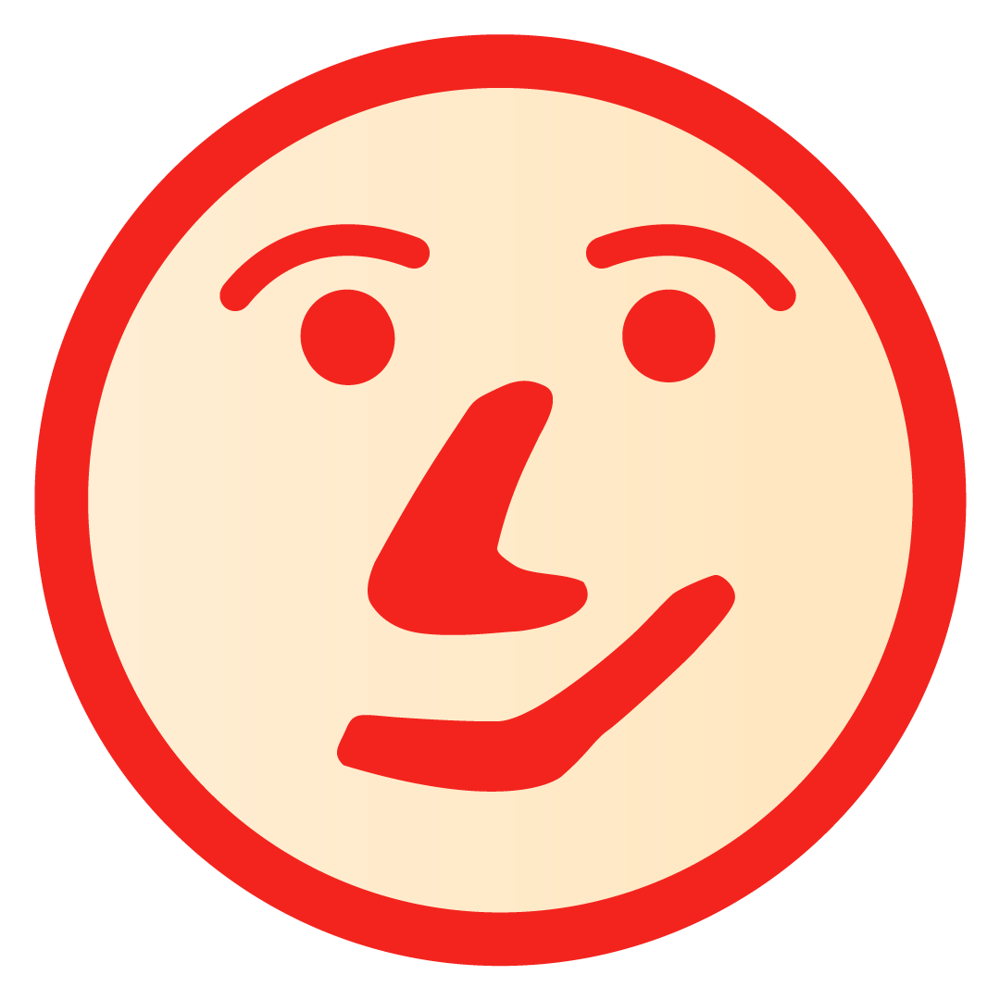

<!-- No DOCTYPE here: Jekyll wraps this file in the Hacker layout, and a DOCTYPE inside the layout body renders as visible text. -->
<html lang="en">
<head>
<meta charset="UTF-8">
<meta name="viewport" content="width=device-width, initial-scale=1.0">
<title>Sassanix Official Page</title>
<!-- Note: the live page is wrapped in the Hacker theme layout by Jekyll, so head tags here do not reach the served head. The served title and description come from the layout and _config.yml. -->
<meta name="description" content="Listen to my latest mixes and see my latest creations.">
<meta property="og:title" content="Sassanix Official Page">
<meta property="og:description" content="Listen to my latest mixes and see my latest creations.">
<meta property="og:type" content="website">
<meta property="og:url" content="https://sassanix.com/">
<meta name="twitter:card" content="summary">
<meta name="theme-color" content="#101114">
<link rel="icon" href="LS8Mx.gif" type="image/gif">

</head>
<body>
<a class="skip" href="#mixes">Skip to latest mixes</a>

<a href="#top">Sassanix</a>

<nav class="site-nav" aria-label="Main navigation">
<a href="#mixes">Latest Mixes</a>
<a href="#about">About Me</a>
<a href="#projects">Open Source</a>
<a href="#contact">Contact Me</a>
</nav>

<main class="wrap" id="top">

<h1>Sassanix</h1>

Listen to my latest mixes and see my latest creations.

<a class="btn btn-primary" href="#mixes">Listen to latest mixes</a>
<a class="btn btn-secondary" href="#contact">Get in touch</a>

<section class="card" id="mixes" aria-labelledby="mixes-heading">
<h2 id="mixes-heading">Latest Mixes</h2>
<iframe class="player" title="Latest Sassanix mixes on Mixcloud" loading="lazy" src="https://www.mixcloud.com/widget/iframe/?feed=%2FSassanix%2F"></iframe>
<a class="mixcloud-link" href="https://www.mixcloud.com/Sassanix/" target="_blank" rel="noopener">View all mixes on Mixcloud</a>
</section>
<section class="card" id="about" aria-labelledby="about-heading">
<h2 id="about-heading">About Me</h2>

I started getting into electronic music in 1999 while walking in a mall and hearing Paul van Dyk (PVD) blasting. Since then, I have been an advocate and a fan of various musical genres.

I have been mixing different styles of electronic music, including trance, since 2010, when I felt I needed to showcase my music to others. I am excited to make more mixes and to mix live.

</section>
<section class="card" id="projects" aria-labelledby="projects-heading">
<h2 id="projects-heading">Open Source Projects</h2>

Recent open source work, most recently updated first.

<ul class="project-list">
<li class="project">
<h3>Warracker</h3>

An open source, self-hostable warranty tracker to monitor expirations, store receipts, and files. You own the data, your rules.

<a href="https://warracker.com" target="_blank" rel="noopener">Visit warracker.com</a>
<a href="https://github.com/sassanix/Warracker" target="_blank" rel="noopener">View on GitHub</a>

</li>
<li class="project">
<h3>wttrterminal</h3>

Weather in your terminal using wttr.in, with setup for Windows PowerShell and Linux Bash.

<a href="https://github.com/sassanix/wttrterminal" target="_blank" rel="noopener">View on GitHub</a>

</li>
</ul>
<a class="projects-more" href="https://github.com/sassanix?tab=repositories" target="_blank" rel="noopener">View all repositories on GitHub</a>
</section>
<section class="card" id="contact" aria-labelledby="contact-heading">
<h2 id="contact-heading">Contact Me</h2>

Feel free to reach out to me through any of the following platforms:

<ul class="contact-list">
<li><a href="https://www.reddit.com/message/compose/?to=Sassanix" target="_blank" rel="noopener">Reddit</a></li>
<!-- TODO: verify Discord link. It uses the old discordapp.com domain and discriminator format. Replace with your current Discord profile or server invite if this no longer works. -->
<li><a href="https://discordapp.com/users/Sassanix#0801/" target="_blank" rel="noopener">Discord</a></li>
<li><a href="https://www.mixcloud.com/Sassanix/" target="_blank" rel="noopener">Mixcloud</a></li>
<li><a href="https://open.spotify.com/user/sassanix" target="_blank" rel="noopener">Spotify</a></li>
<li><a href="https://www.facebook.com/sassanix" target="_blank" rel="noopener">Facebook</a></li>
<li><a href="https://soundcloud.com/sassanix" target="_blank" rel="noopener">Soundcloud</a></li>
<li><a href="https://www.reddit.com/r/sassanix" target="_blank" rel="noopener">Reddit Community</a></li>
</ul>
</section>
<!-- Buy Me a Coffee button. No defer: the script does not render the button with defer. -->

</main>
<footer>

&copy; 2026 Sassanix Music. All rights reserved.

</footer>
</body>
</html>
